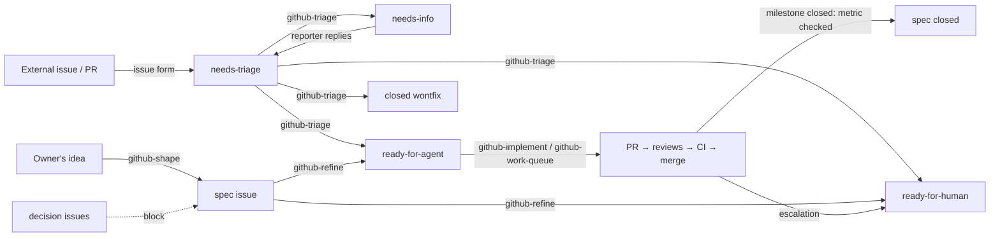

# Claude Code personal configuration

Versioned subset of `~/.claude`: my engineering baseline and the skills that apply it. The repo
lives in place, so Claude Code loads it directly in every session.

## At a glance

- **What it is**: a methodology, not an application — a personal engineering baseline
  ([`common.md`](skills/quality-baseline/references/common.md), everyday rules in
  [`CLAUDE.md`](CLAUDE.md)) plus skills that set up repositories against it and run a
  GitHub-native loop — the owner's ideas are shaped and external reports triaged, then refined →
  implemented → reviewed → merged, autonomously where a repo allows it.
- **Use it**: in any repo, `/quality-baseline` to set up or audit quality gates, then
  `/github-workflow-setup` to enable the issue workflow. See [Setting up a repository](#setting-up-a-repository).
- **Quality**: documentation checks in CI ([Docs workflow](.github/workflows/docs.yml)); behavioural
  scenarios per workflow skill (`skills/*/evals/`); decisions in [docs/decisions/](docs/decisions/README.md).

## Contents

| Path | What it is |
|---|---|
| [`CLAUDE.md`](CLAUDE.md) | Global instructions loaded in every session: everyday engineering rules and working agreements. |
| `skills/<name>/SKILL.md` | One skill per folder; `references/`, `templates/` and `evals/` beside it. |
| [`docs/decisions/`](docs/decisions/README.md) | ADRs for this repository. |
| [`docs/credits.md`](docs/credits.md) | Prior art the GitHub workflow skills are modeled on. |
| [`docs/upstream-watch.md`](docs/upstream-watch.md) | How far `check-upstream-skills` has reviewed upstream. |
| [`docs/model-watch.md`](docs/model-watch.md) | When and how the per-skill model assignment is reviewed, and its log. |
| [`.github/`](.github/) | Docs CI, its validation script, Dependabot and the ruleset to apply once public. |

Everything else in `~/.claude` (history, sessions, caches, `settings.json`) is private runtime
state, excluded by the whitelist in [`.gitignore`](.gitignore).

## Skills

**Starts automatically** means Claude may invoke the skill on its own when the request matches its
`description`; every skill can also be started explicitly with `/<name>`. **Manual only** skills
set `disable-model-invocation: true`: only typing the slash command starts them.

| Skill | Use it to | Starts | Model | Notes |
|---|---|---|---|---|
| [`quality-baseline`](skills/quality-baseline/SKILL.md) | Set up or audit a repo against the baseline (tests, CI gates, pre-push, rulesets, Docker, ADRs…). | Automatically | `sonnet` | C# templates in `templates/csharp/`; language references in `references/`. |
| [`adr`](skills/adr/SKILL.md) | Write, propose, supersede or list ADRs (MADR 4.0). | Automatically | `opus` | |
| [`github-workflow-setup`](skills/github-workflow-setup/SKILL.md) | Set up or audit a repo's issue workflow; or get a reminder of the cycle. | Automatically | `sonnet` | Asks before widening any permission. |
| [`github-shape`](skills/github-shape/SKILL.md) | Shape an idea into a `spec` issue with a success metric; resolve its decisions; close it checking the metric. | Automatically | `opus` | Starts from the owner's position; shows the draft before publishing. |
| [`github-triage`](skills/github-triage/SKILL.md) | Classify incoming external issues and PRs. | Automatically | `sonnet` | Proposes; applies only after approval. |
| [`github-refine`](skills/github-refine/SKILL.md) | Turn an agreed spec into a milestone of tracer-bullet issues, briefing the frontier and outlining the rest; re-refine after a pivot. | Automatically | `opus`, effort high | Shows the draft before publishing. |
| [`github-implement`](skills/github-implement/SKILL.md) | Implement one `ready-for-agent` issue with TDD, up to an open PR. | Automatically, e.g. `/github-implement 42` | `sonnet` | Runs in a forked context; needs the issue number. |
| [`github-work-queue`](skills/github-work-queue/SKILL.md) | Work through the `ready-for-agent` backlog unattended. | **Manual only** | `sonnet`; reviewers `opus` | Merges PRs where the repo allows it. |
| [`check-upstream-skills`](skills/check-upstream-skills/SKILL.md) | Review [mattpocock/skills](https://github.com/mattpocock/skills) for improvements; check the model assignment. | **Manual only** | session | Occasional, on demand. |

The built-in `code-review` and `security-review` skills are reused as the review gate of the work
queue.

**Model** is a family alias, so each skill follows that family's latest model; the assignment by
role and how it is kept current: [ADR 0003](docs/decisions/0003-assign-models-per-skill-by-role.md)
(`github-shape`, added later, is `opus` per [ADR 0004](docs/decisions/0004-three-layer-baseline-decisions-shaping-implementation.md)),
[`docs/model-watch.md`](docs/model-watch.md).

## Setting up a repository

Requirements: Claude Code, the [GitHub CLI](https://cli.github.com/) authenticated with access to
the repo (`gh auth status`), and — for branch rulesets — a public repo or a paid GitHub plan.

1. **Quality baseline** — `/quality-baseline`. Detects what exists, agrees a plan with you, then
   scaffolds tests, CI, pre-push hook, rulesets, Docker, README, repo `CLAUDE.md` and
   `.claude/settings.json`. What it applies:
   [`references/common.md`](skills/quality-baseline/references/common.md).
2. **Issue workflow** — `/github-workflow-setup`. Creates the
   [labels](skills/github-workflow-setup/references/labels.md), `docs/agents/workflow.md` (from
   [the template](skills/github-workflow-setup/templates/workflow.md)), the
   [issue forms](skills/github-workflow-setup/templates/ISSUE_TEMPLATE/) and the
   [`needs-info-reply` workflow](skills/github-workflow-setup/templates/workflows/needs-info-reply.yml).
3. **Autonomy** — during step 2 it asks whether agents may push and merge in that repo and writes
   the answer in three places that must agree: the repo's `CLAUDE.md`, its `.claude/settings.json`
   and `docs/agents/workflow.md`. Details: [`references/autonomy.md`](skills/github-workflow-setup/references/autonomy.md);
   rationale: [ADR 0002](docs/decisions/0002-per-repository-push-and-merge-policy.md). A repo
   without a policy means "ask before every push".

Re-run either skill at any time to audit the repo; `github-workflow-setup` with nothing to change
just explains the cycle.

### Adopting it in an existing repository

Both skills start with an audit when the repo already has content: they report what is present,
missing or deviating, agree a plan with you, and only then change things; existing files are
merged into, never overwritten. In short: audit, retroactive ADRs, formatting in its own commit,
gates added without a red build, README restructured, then the issue workflow with autonomy
widened last. The full order:
[`common.md` › *Adopting the baseline in an existing repository*](skills/quality-baseline/references/common.md#adopting-the-baseline-in-an-existing-repository).

## How the GitHub workflow works

Design: [ADR 0001](docs/decisions/0001-github-driven-triage-refinement-and-autonomous-implementation.md),
extended with shaping by [ADR 0004](docs/decisions/0004-three-layer-baseline-decisions-shaping-implementation.md).



- **Mapping**: `spec` issue = the shaped what and why, linked from its milestone; milestone = epic; issue = tracer-bullet ticket
  ([slicing rules](skills/github-refine/references/tracer-bullets.md)); "blocked by" = GitHub's
  native issue dependencies ([how they're written and checked](skills/github-workflow-setup/references/dependencies.md)).
- **States**: [triage state machine](skills/github-triage/references/states.md). Each issue
  ready for work carries an [agent brief](skills/github-triage/references/brief-format.md):
  acceptance criteria, what was verified, and the *Sensitive areas* pre-approved for the agent.
- **Autonomy has three layers**: per issue (`ready-for-agent` vs `ready-for-human`), per repo
  (push policy and `Unattended merge` in `docs/agents/workflow.md`), and GitHub's own ruleset
  (required checks, no force-push), which agent merges never bypass.
- **Per-ticket loop** of the work queue: implement in a subagent → `code-review` and
  `security-review` in parallel, each in its own worktree on the PR branch → one fix round →
  CI → merge or hand off → checkpoint → recompute the frontier. A stuck ticket is relabeled
  `ready-for-human` with a comment and the queue moves on. Details: [queue policy](skills/github-work-queue/references/queue-policy.md);
  stop conditions: [delivery](skills/github-implement/references/delivery.md).
- **Just-in-time refinement and findings**: `github-refine` briefs only the frontier; the other
  slices are outlines. After each ticket with findings (its PR's *Learned* section, the reviews'
  non-blocking items), a `sonnet` checkpoint that reads no code routes them by the
  [findings rule](skills/github-workflow-setup/references/findings.md) — a new ticket or an edited
  brief in the same milestone on its own, a `decision` or a discard for the owner — and briefs the
  outlines that reached the frontier; an outline that no longer fits is a pivot for
  `github-refine`. The milestone escalates once discovered work passes 50 % of its original size.
  Design: [ADR 0005](docs/decisions/0005-adaptive-milestones-findings-rule-and-two-level-design-records.md) (proposed).
- **What touches GitHub**, all through `gh`:

  | Skill | Reads | Writes |
  |---|---|---|
  | `github-workflow-setup` | labels, rulesets | labels (after confirmation) |
  | `github-shape` | README, ADRs, `spec`/`decision` issues | `spec` and `decision` issues, dependencies, comments, closes the spec — after approval |
  | `github-triage` | issues, PR diffs (never checks out or runs external PRs) | labels, comments, closes `wontfix` — after approval |
  | `github-refine` | milestones | milestone, issues, dependencies — after approval |
  | `github-implement` | issue, dependencies | branch push, PR (only if the push policy allows) |
  | `github-work-queue` | issues, PR checks | merges, relabels escalated issues; checkpoint: new tickets, briefs, labels, spec *Decisions*, PR comments; R5 discards after approval |

- **Notifications**: GitHub's own. The triage comment on a `needs-info` issue notifies the
  reporter; their reply notifies you and the `needs-info-reply` workflow sends it back to
  `needs-triage`. Escalated tickets get a comment explaining why.

## Changing this repository

- **Conventions**: skills in English, one folder each, `SKILL.md` kept short with detail in
  `references/`. Architecturally significant changes get an ADR (`adr` skill).
- **Checks**: `python3 .github/scripts/validate.py` (skill frontmatter, relative links, YAML/JSON)
  and `shellcheck` on template scripts — the same as the [Docs workflow](.github/workflows/docs.yml).
- **Behaviour**: before a significant edit to a workflow skill, walk through its
  `evals/scenarios.md` and confirm each expected behaviour still holds.
- **Upstream and models**: `/check-upstream-skills` now and then — it also checks the model
  assignment against [docs/model-watch.md](docs/model-watch.md); credits in [docs/credits.md](docs/credits.md).

### Overrides of the baseline

This repo holds documentation and templates, not an application, so:

| Baseline item | Here | Why |
|---|---|---|
| Unit/component/load tests, SLO, coverage | Behavioural scenarios (`evals/`) | Skills are prose; templates are verified in the repos they come from. |
| Build, CodeQL, Docker | Docs CI (frontmatter, links, YAML/JSON, shellcheck) | No executable product. |
| One PR per step, review via PR | Direct commits to `main` by the owner (ruleset bypass); PRs for everyone else | Single maintainer, nothing for PR CI to gate beyond the docs checks. |
| Pre-push hook | Run `validate.py` manually | A hook needs `core.hooksPath` in `.git/config`, which isn't versioned. |
| Push policy | Ask before every push | Default from [ADR 0002](docs/decisions/0002-per-repository-push-and-merge-policy.md). |

### Repository protection

The repo is public; the versioned files contain no personal data beyond my name and GitHub
username, and commits use the GitHub noreply email. `main` is protected by the ruleset in
`.github/rulesets/main.json` (applied with
`gh api -X POST repos/{owner}/{repo}/rulesets --input .github/rulesets/main.json`): no deletion or
force-push; everyone else goes through a PR with the docs check green, while the repo admin
bypasses it to commit directly. Secret scanning with push protection is enabled.

## Next steps

Open work on this repository, in order. Remove an item when it lands; the reasoning lives in the
linked ADR.

1. **Measure [ADR 0004](docs/decisions/0004-three-layer-baseline-decisions-shaping-implementation.md)**:
   its success measure is that the next three milestones start from a `spec` issue naming a
   success metric (baseline 0 on 2026-10-14). Close each spec with `github-shape`'s close-out and
   record the count here; if most work needed no shaping, revisit the ADR (option C).
2. **Widen `check-upstream-skills`** to watch [addyosmani/agent-skills](https://github.com/addyosmani/agent-skills)
   and the pstack port [michael-denyer/pstack-claude](https://github.com/michael-denyer/pstack-claude)
   besides mattpocock/skills, with a marker per source in `docs/upstream-watch.md` (ADR 0004).
3. **After a couple of milestones on the new flow**: a `retro` skill that turns mechanical lessons
   into checks rather than instructions, and review flags for a lowered bar — thresholds edited
   down, skipped or deleted tests, new suppressions (ADR 0004, implementation layer).

## New machine

```bash
git clone https://github.com/alvaromongon/claude-config.git /tmp/claude-config
cp -R /tmp/claude-config/. ~/.claude/
```

## AI-assisted development

This repository is written with Claude Code, following the same working agreements it defines:
analysis and alternatives discussed before non-trivial changes, decisions recorded as ADRs, and
every change reviewed by me before it's pushed.
