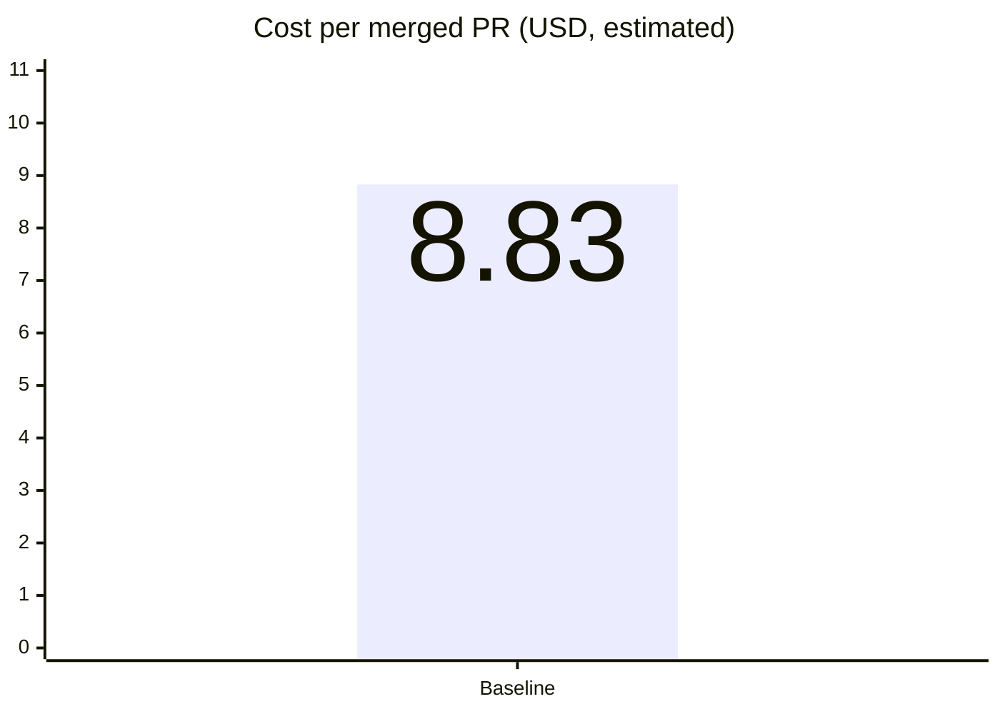
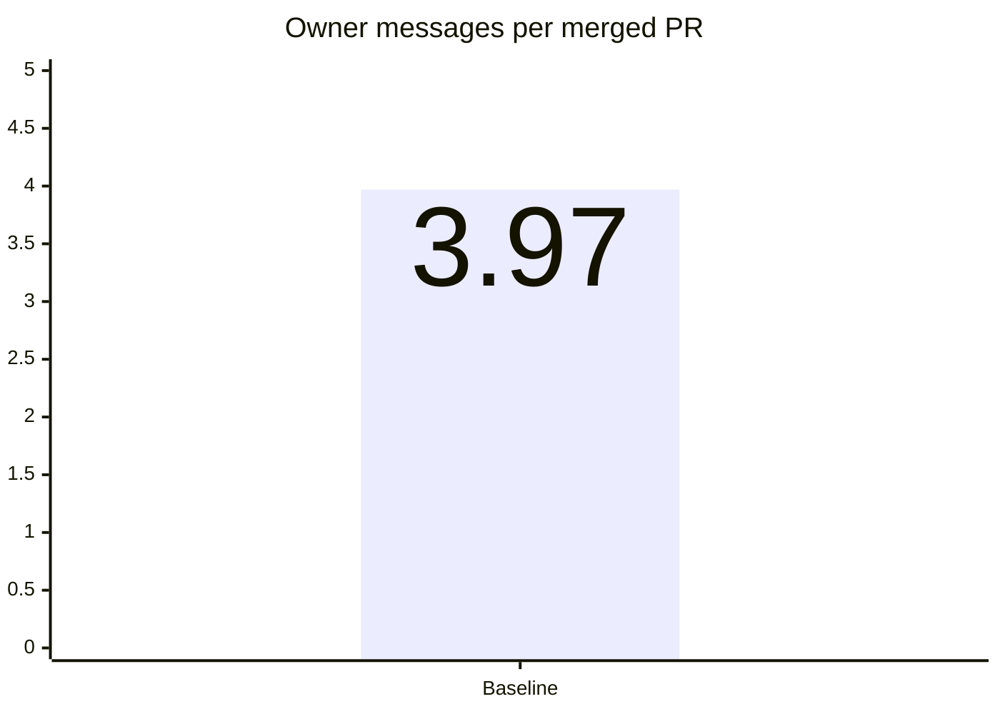
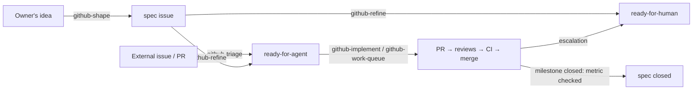

# Claude Code configuration

**An engineering baseline and a GitHub-native agent workflow for Claude Code — measured, not
assumed.**

[](https://github.com/alvaromongon/claude-config/actions/workflows/docs.yml)

[Efficiency](#efficiency) · [Get started](#get-started) · [Skills](#skills) ·
[How it works](#how-it-works) · [Decisions](docs/decisions/README.md)

## What it is

- **A personal engineering baseline**: tests, CI gates, pre-push hook, rulesets, ADRs and Docker,
  following each language's official conventions — defined in
  [`common.md`](skills/quality-baseline/references/common.md), with everyday rules in
  [`CLAUDE.md`](CLAUDE.md).
- **Skills that apply it**: they set up or audit a repo, then run a loop on GitHub where ideas are
  shaped, reports triaged, specs refined into tickets, and tickets implemented, reviewed and merged
  — autonomously where a repo allows it.
- **Measured**: every change to this configuration is judged by what it does to cost and quality
  on real work, below.

This is the versioned part of `~/.claude`, so Claude Code loads it directly in every session;
everything else there (history, sessions, caches, `settings.json`) is private runtime state, kept
out by the whitelist in [`.gitignore`](.gitignore).

## Efficiency

Measured on real work in public repos from Claude Code's session transcripts; only aggregates are
published. History, method and how a window is recorded: [docs/efficiency.md](docs/efficiency.md).

<!-- efficiency:snapshot:start -->
Latest window: **Baseline** on `alvaromongon/finance-agent`, 2026-10-16 → 2026-10-26, 31 merged PRs (baseline, no change measured yet).

| Metric | Latest | vs baseline |
|---|---|---|
| Cost per merged PR (estimated, list prices) | $8.83 | = |
| Owner messages per merged PR | 3.97 | = |
| PRs clean at first review | 38% | = |
| Active agent minutes per merged PR | 35 | = |




<!-- efficiency:snapshot:end -->

## Get started

Requirements: Claude Code, the [GitHub CLI](https://cli.github.com/) authenticated with access to
the repo (`gh auth status`), and — for branch rulesets — a public repo or a paid GitHub plan.

```bash
git clone https://github.com/alvaromongon/claude-config.git /tmp/claude-config
cp -R /tmp/claude-config/. ~/.claude/
```

Then, in any repository:

1. **`/quality-baseline`** — detects what exists, agrees a plan with you, then scaffolds tests,
   CI, pre-push hook, rulesets, Docker, README, repo `CLAUDE.md` and `.claude/settings.json`.
2. **`/github-workflow-setup`** — creates the
   [labels](skills/github-workflow-setup/references/labels.md), `docs/agents/workflow.md`, the
   issue forms and the `needs-info-reply` workflow.
3. **Autonomy** — during step 2 you decide whether agents may push and merge in that repo; the
   answer is written to its `CLAUDE.md`, `.claude/settings.json` and `docs/agents/workflow.md`
   ([details](skills/github-workflow-setup/references/autonomy.md)). No policy means "ask before
   every push".

Re-run either skill at any time to audit the repo. In a repo that already has content both start
with an audit and change nothing before you agree the plan —
[adoption order](skills/quality-baseline/references/common.md#adopting-the-baseline-in-an-existing-repository).

## Skills

**Automatically** means Claude may start the skill when a request matches its `description`;
every skill can also be started with `/<name>`. **Manual only** skills start only from the slash
command.

| Skill | Use it to | Starts | Model |
|---|---|---|---|
| [`quality-baseline`](skills/quality-baseline/SKILL.md) | Set up or audit a repo against the baseline. | Automatically | `sonnet` |
| [`adr`](skills/adr/SKILL.md) | Write, propose, supersede or list architecture decisions (MADR 4.0). | Automatically | `opus` |
| [`github-workflow-setup`](skills/github-workflow-setup/SKILL.md) | Set up or audit a repo's issue workflow; explain the cycle. | Automatically | `sonnet` |
| [`github-shape`](skills/github-shape/SKILL.md) | Shape an idea into a `spec` issue with a success metric; close it checking the metric. | Automatically | `opus` |
| [`github-triage`](skills/github-triage/SKILL.md) | Classify incoming external issues and PRs. | Automatically | `sonnet` |
| [`github-refine`](skills/github-refine/SKILL.md) | Turn a spec into a milestone of tracer-bullet tickets; re-refine after a pivot. | Automatically | `opus`, effort high |
| [`github-implement`](skills/github-implement/SKILL.md) | Implement one `ready-for-agent` issue with TDD, up to an open PR. | Automatically | `sonnet` |
| [`github-work-queue`](skills/github-work-queue/SKILL.md) | Work through the `ready-for-agent` backlog unattended, merging where allowed. | **Manual only** | `sonnet` (start the session with `--model sonnet`); reviewers `opus` |
| [`session-metrics`](skills/session-metrics/SKILL.md) | Measure a repo's sessions: cost per merged PR, review rounds, owner messages, time. | Automatically | `sonnet` |
| [`check-upstream-skills`](skills/check-upstream-skills/SKILL.md) | Review upstream skill repos for improvements; check the model assignment. | **Manual only** | session |

The built-in `code-review` and `security-review` skills are the review gate of the work queue.
Models are family aliases assigned by role
([ADR 0003](docs/decisions/0003-assign-models-per-skill-by-role.md), reviewed in
[model-watch.md](docs/model-watch.md)).

## How it works



Labels, states, the per-ticket loop, findings and what each skill touches on GitHub:
[docs/workflow.md](docs/workflow.md).

## Learn more

| Document | What it covers |
|---|---|
| [docs/workflow.md](docs/workflow.md) | The GitHub workflow cycle in full. |
| [docs/efficiency.md](docs/efficiency.md) | Efficiency history, method and how a window is recorded. |
| [docs/decisions/](docs/decisions/README.md) | Architecture decisions (ADRs) for this repo. |
| [docs/maintaining.md](docs/maintaining.md) | Changing this repo: conventions, checks, overrides of the baseline, protection, next steps. |
| [docs/model-watch.md](docs/model-watch.md) · [docs/upstream-watch.md](docs/upstream-watch.md) | Reviews of the model assignment and of upstream skills. |
| [docs/credits.md](docs/credits.md) | Prior art the workflow skills are modeled on. |

## AI-assisted development

This repository is written with Claude Code, following the same working agreements it defines:
analysis and alternatives discussed before non-trivial changes, decisions recorded as ADRs, and
every change reviewed by me before it's pushed.
