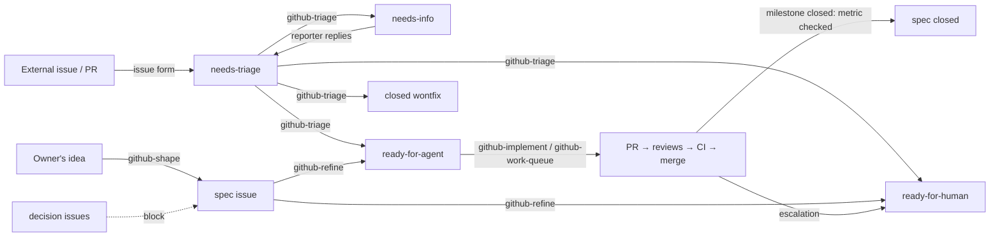

# How the GitHub workflow works

The cycle the `github-*` skills run in a repository set up with `/github-workflow-setup`.

Design: [ADR 0001](decisions/0001-github-driven-triage-refinement-and-autonomous-implementation.md),
extended with shaping by [ADR 0004](decisions/0004-three-layer-baseline-decisions-shaping-implementation.md).

- **Mapping**: `spec` issue = the shaped what and why, linked from its milestone; milestone = epic; issue = tracer-bullet ticket
  ([slicing rules](../skills/github-refine/references/tracer-bullets.md)); "blocked by" = GitHub's
  native issue dependencies ([how they're written and checked](../skills/github-workflow-setup/references/dependencies.md));
  the order between milestones = real blocking edges between their specs, never a preference.
- **States**: [triage state machine](../skills/github-triage/references/states.md). Each issue
  ready for work carries an [agent brief](../skills/github-triage/references/brief-format.md):
  acceptance criteria, what was verified, and the *Sensitive areas* pre-approved for the agent.
- **Autonomy has three layers**: per issue (`ready-for-agent` vs `ready-for-human`), per repo
  (push policy and `Unattended merge` in `docs/agents/workflow.md`), and GitHub's own ruleset
  (required checks, no force-push), which agent merges never bypass.
- **Per-ticket loop** of the work queue: implement in a subagent → `code-review` and
  `security-review` in parallel, each in its own worktree on the PR branch → one fix round →
  CI → merge or hand off → checkpoint → recompute the frontier. A stuck ticket is relabeled
  `ready-for-human` with a comment and the queue moves on. Details: [queue policy](../skills/github-work-queue/references/queue-policy.md);
  stop conditions: [delivery](../skills/github-implement/references/delivery.md).
- **Just-in-time refinement and findings**: `github-refine` briefs only the frontier; the other
  slices are outlines. After each ticket with findings (its PR's *Learned* section, the reviews'
  non-blocking items), a `sonnet` checkpoint that reads no code routes them by the
  [findings rule](../skills/github-workflow-setup/references/findings.md) — a new ticket or an edited
  brief in the same milestone on its own, a `decision` or a discard for the owner — and briefs the
  outlines that reached the frontier; an outline that no longer fits is a pivot for
  `github-refine`. The milestone escalates once discovered work passes 50 % of its original size.
  Design: [ADR 0005](decisions/0005-adaptive-milestones-findings-rule-and-two-level-design-records.md) (proposed).
- **Design records**: ADRs record architecture only and, when they come out of an open milestone,
  stay `Proposed` until the spec's close-out, which accepts them with the milestone's data and
  moves the design detail from the spec's *Decisions* into the repo's `docs/flows.md`
  ([`quality-baseline` › *Flow document*](../skills/quality-baseline/references/common.md)).
- **What touches GitHub**, all through `gh`:

  | Skill | Reads | Writes |
  |---|---|---|
  | `github-workflow-setup` | labels, rulesets | labels (after confirmation) |
  | `github-shape` | README, ADRs, `spec`/`decision` issues | `spec` and `decision` issues, dependencies, comments, closes the spec — after approval |
  | `github-triage` | issues, PR diffs (never checks out or runs external PRs) | labels, comments, closes `wontfix` — after approval |
  | `github-refine` | milestones | milestone, issues, dependencies — after approval |
  | `github-implement` | issue, dependencies | branch push, PR (only if the push policy allows) |
  | `github-work-queue` | issues, PR checks | merges, relabels escalated issues; checkpoint: new tickets, briefs, labels, spec *Decisions*, PR comments; R5 discards after approval |

- **Notifications**: GitHub's own. The triage comment on a `needs-info` issue notifies the
  reporter; their reply notifies you and the `needs-info-reply` workflow sends it back to
  `needs-triage`. Escalated tickets get a comment explaining why.
